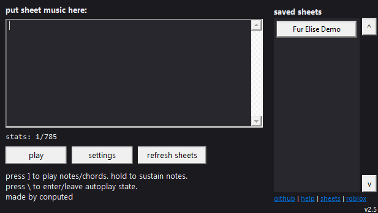
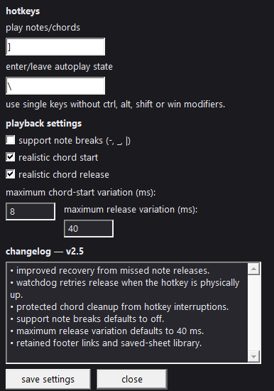

# Conputed's Virtual Piano Autoplayer

A lightweight AutoHotkey script for playing Virtual Piano sheets in Roblox.

**Conputed's Virtual Piano Autoplayer** lets you play sheet music using your own keyboard. It supports notes, chords, customizable settings, and a built-in sheet library where you can save and manage your favorite songs.

Unlike a fully automatic player, this tool uses **manual autoplay** — you control when notes and chords are played, so a little timing and coordination are involved.

## Screenshots

### Main GUI

The main interface, where you can load sheets and control playback.

### Settings GUI

The settings interface, where you can customize playback behavior.

## Features

- **Manual playback** — trigger notes and chords with a single hotkey.
- **Sheet library** — save and manage your own piano sheets.
- **Customizable controls** — adjust hotkeys and playback settings.
- **Chord support** — play multiple notes together.
- **Timing options** — customize note start and release timing.
- **Note breaks** — optionally support breaks in compatible sheets.
- **Saved settings** — your preferences persist between sessions.
- **Simple interface** — manage playback and sheets through a clean GUI.

## Getting Started

### 1. Install AutoHotkey

This script requires **AutoHotkey v2 for Windows**.

Download it from the official website:

[**Download AutoHotkey v2**](https://www.autohotkey.com/)

Make sure you install **version 2**, not version 1.

### 2. Download the Autoplayer

1. Open this repository on GitHub.
2. Click the green **Code** button.
3. Select **Download ZIP**.
4. Extract the ZIP file to a folder on your computer.

### 3. Launch the Script

1. Open the extracted folder.
2. Find the `.ahk` script file.
3. Double-click it to launch the Autoplayer.

If the script does not open, check that AutoHotkey v2 is installed correctly.

### 4. Open Roblox

1. Launch Roblox and enter a game that supports Virtual Piano.
2. Make sure the piano is ready to receive keyboard input.
3. Keep the game open while using the Autoplayer.

## Controls

| Default Key | Action |
| --- | --- |
| `]` | Play the next note or chord |
| `\` | Enter or leave the autoplay state |

The `]` key triggers the next part of the sheet. Depending on the notation, this may be a single note or multiple notes played together as a chord.

**Tip:** Start with a short, simple sheet to get used to the timing before trying more complicated songs.

## Using Your Own Sheets

You can add your own Virtual Piano sheets by saving them as `.txt` files in the `sheets` folder.

### Adding a Sheet

1. Find a Virtual Piano sheet you want to play.
2. Copy the sheet notation.
3. Open the `sheets` folder inside the Autoplayer's folder.
4. Create a new text file ending in `.txt`.
5. Paste the sheet notation into the file and save it.
6. Give the file a recognizable name, such as `song.txt`.
7. Open the Autoplayer and select your saved sheet from the library to load it into the text box.

Your saved sheets remain in the `sheets` folder, so you can add, edit, or remove them whenever you want.

## Supported Notation

The Autoplayer recognizes the following notation:

- **Single notes:** Individual characters from a Virtual Piano sheet.
- **Chords:** Notes grouped inside square brackets, such as `[adg]`.
- **Spacing:** Spaces, line breaks, tabs, and slashes are skipped.
- **Note breaks:** `-`, `_`, and `|` can represent breaks when note-break support is enabled.

Not every sheet uses exactly the same format. If a sheet plays incorrectly, check its notation and make sure your settings match the sheet.

## Settings

The Autoplayer includes options for adjusting playback to your preference.

| Setting | Default | Description |
| --- | --- | --- |
| Support note breaks | Off | Enables break markers in compatible sheets. |
| Realistic chord start | On | Adds small timing variations when starting chord notes. |
| Realistic chord release | On | Adds small timing variations when releasing chord notes. |
| Maximum start delay | 8 ms | Sets the maximum randomized start delay. |
| Maximum release delay | 40 ms | Sets the maximum randomized release delay. |

Experiment with these options to find what works best for your sheet and the game you're playing.

Your settings are saved automatically, so you shouldn't need to configure them every time you launch the script.

## Troubleshooting

### The script won't open

- Make sure AutoHotkey v2 is installed.
- Confirm that you're running the `.ahk` file and not opening it in a text editor.

### Notes aren't playing in Roblox

- Make sure the correct Roblox game is open and the piano is ready.
- Check that the game is receiving keyboard input.
- Confirm that the Autoplayer is running and your hotkeys are configured correctly.

### A sheet plays incorrectly

- Check that the sheet uses compatible Virtual Piano notation.
- Make sure chord brackets and note breaks are formatted correctly.
- Try a short test sheet to narrow down the problem.

### A note or chord stays held

- Release the note hotkey and stop playback if necessary.
- If the problem continues, restart the script and check whether it happens consistently.

## Credits

Created by **[Conputed](https://github.com/RealConputed)**.

You're welcome to modify this project to suit your needs. If you redistribute your own version, please give credit to the original creator.

## Disclaimer

This is an independent community project and is not affiliated with or endorsed by Roblox. Use it responsibly and follow the rules of the game you're playing.
